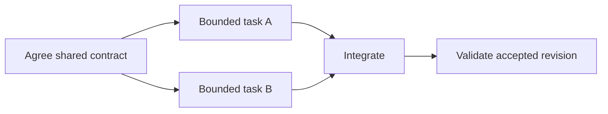

# Bound parallel agent work

## Presentation

```yaml
version: 1
title: Bound parallel agent work
```

## Slide: Delegate an outcome with a boundary

```yaml
id: contracts
type: material
chapter: Read
source: Course book chapter 7; adapted from lecture 07
study:
  explanation: |-
    Parallel work is useful when tasks have settled inputs and can produce independently reviewable results. Ambiguous shared interfaces create waiting and rework even when many agents are active.

    The objective is accepted outcomes per constrained human attention. Distinguish authority to propose, implement, review, integrate, and perform external actions.
```

| Task contract            | Evidence                        |
| ------------------------ | ------------------------------- |
| Observable outcome       | One acceptance check            |
| Bounded change surface   | Named files or interface        |
| Inputs and dependencies  | Settled shared contract         |
| Integration and stopping | Named owner and escalation rule |

[Read the chapter](./../../../chapters/agent-fleets/)

## Slide: Sequential review limits ideal speedup

```yaml
id: speedup
type: material
chapter: Experiment
source: Course book chapter 7; adapted from lecture 07
demo: ./amdahl.html
demoPoster: ./amdahl.svg
study:
  explanation: |-
    Amdahl's model assumes a fixed workload with parallel fraction p and N workers: S(N) = 1 / ((1 − p) + p/N). At p = 0.8 and N = 4, ideal speedup is 2.5×. The ideal ceiling as N grows is 5×.

    Integration, review, coordination, and rework can reduce actual gains. Estimate the fractions from evidence instead of treating the model's inputs as measured productivity.
  prompt: Keep parallel work at 80%. Compare four and sixteen workers. Which sequential activity would you investigate before adding more workers?
  answer: The ideal speedup grows from 2.5× to 4×, approaching the 5× ceiling. More workers do not remove the sequential fraction. Investigate review or integration using a task trace and measure accepted completion time, including failed attempts and rework.
```

Treat a worker count as a model input, not a recommended fleet size.

[Try the feature-and-review exercise](./../../../chapters/agent-fleets/#exercise-fleets-amdahl).
Predict whether doubling the fleet doubles accepted output before calculating.
Explain what happens to the review queue, then change one assumption and name the evidence you would collect before adding agents.

## Slide: When should a task wait?

```yaml
id: check
type: poll
room: study-pilot-fleets
chapter: Check
source: Course book chapter 7; adapted from lecture 07
poll:
  question: Which action most directly addresses the dependency?
  options:
    - id: option-0
      label: Start more implementers immediately
    - id: option-1
      label: Let each invent a contract and defer all review
    - id: option-2
      label: Settle the shared contract and identify integration ownership
  defaultId: option-0
study:
  answer: Settle the shared contract and identify integration ownership. More activity does not remove the prerequisite. Independent exploration may still be useful, but implementation should have explicit dependencies, validation gates, and a stopping rule.
  correctOption: option-2
```

Two implementers need incompatible versions of the same unsettled interface.

## Slide: Keep integration inspectable

```yaml
id: trace
type: material
chapter: Read
source: Course book chapter 7; adapted from lecture 07
study:
  explanation: |-
    A fleet is complete when its outputs converge into one reviewable artifact. Preserve task dependencies, ownership, changed artifacts, check outcomes, and failed or retried attempts.

    A trace can explain waiting and rework, but it does not prove a tool caused the final result. Compare equivalent scope and acceptance standards, and inspect the integrated revision.
```



Keep the integration gate even when both task-level checks pass.

## Slide: Design two independent tasks

```yaml
id: apply
type: question
chapter: Apply
source: Course book chapter 7; adapted from lecture 07
study:
  prompt: Split a small feature into two tasks only if they can proceed independently after a shared prerequisite. Specify each outcome, change surface, acceptance check, and escalation rule. Who validates the combined result?
  answer: For example, a settled API contract may permit a client view and server handler to develop separately. Both need focused checks; the integrator also tests authorization, errors, and the full request path. If the contract is still disputed, record that dependency rather than claiming immediate parallel progress.
```

[Explore connections across the book](./../../../concepts/?reading=%2Fchapters%2Fagent-fleets%2F).
Explain one connection before opening the definition, then follow it to another reading and check where the analogy stops.

[All modules](./../index.html) or [return to the book](./../../../).
