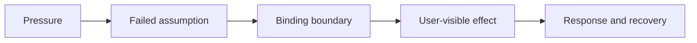

# Expose an assumption under pressure

## Presentation

```yaml
version: 1
title: Expose an assumption under pressure
```

## Slide: Make the failure chain explicit

```yaml
id: chain
type: material
chapter: Read
source: Course book chapter 6; adapted from lecture 06
study:
  explanation: |-
    A local success can depend on assumptions about overlap, retries, data size, tenancy, or dependency recovery. Choose a pressure that could expose one of those assumptions rather than running every possible scenario.

    Separate documented source facts from your interpretation when using an incident. A similar symptom in your application does not establish the same cause.
```



Name the first signal that would distinguish this chain from another explanation.

[Read the chapter](./../../../chapters/reality/)

## Slide: Retry identity must reach the effect owner

```yaml
id: retry
type: material
chapter: Experiment
source: Course book chapter 6; adapted from lecture 06
demo: ./request-path.html
demoPoster: ./request-path.svg
study:
  explanation: |-
    A timeout can occur after a write commits. Deduplication is useful only if the identity reaches the component that owns the effect and remains meaningful within a stated scope and retention window.

    The demo assumes atomic storage of the effect and its result. Separate external side effects need their own coordination and recovery design.
  prompt: Compare the lost-response and same-key retry scenarios at the final boundary. What assumption would fail if the deduplication record expired first?
  answer: The same-key retry finds one stored effect within the model's retention window. After the record expires, the example's guarantee no longer follows. A real test must cover identity scope, retention, concurrent attempts, and recovery rather than just the happy-path retry.
```

Predict both the durable state and the caller's knowledge.

[Try the status-and-activity retry exercise](./../../../chapters/reality/#exercise-pressure-retries).
Name every promised effect before checking your answer, then explain whether the verdict would change if the extra record were only a diagnostic request log.
Use [Appendix C](./../../../appendices/advanced-web-boundaries/#distinguish-http-method-semantics-from-domain-retry-safety) for the HTTP method distinction.

## Slide: Distinguish concurrency safety from appearance

```yaml
id: check
type: poll
room: study-pilot-pressure
chapter: Check
source: Course book chapter 6; adapted from lecture 06
poll:
  question: What is the strongest evidence of a safe result?
  options:
    - id: option-0
      label: Both clients show a successful animation
    - id: option-1
      label: The final state and event history preserve the declared invariant
    - id: option-2
      label: Each request passed when run alone
  defaultId: option-0
study:
  answer: Inspect the final state and event history together under overlapping attempts. Depending on the contract, one request may win and the other be rejected or return the prior outcome. Independent successful runs do not expose a race, and the UI may hide duplicate durable events.
  correctOption: option-1
```

Two clients attempt the same state transition concurrently.

## Slide: A response brings a new obligation

```yaml
id: responses
type: material
chapter: Read
source: Course book chapter 6; adapted from lecture 06
study:
  explanation: |-
    Retries, admission control, asynchronous work, and degradation address different failed assumptions. Each changes what users or operators must handle.

    Keep a primary workload comparable when contrasting implementations. Add a focused secondary pressure only when it can reveal a meaningful consequence of their architectural difference.
```

| Failed assumption                | Candidate response            | Check afterward                         |
| -------------------------------- | ----------------------------- | --------------------------------------- |
| Retries are harmless             | Idempotency and deduplication | Concurrent retry and retention          |
| Demand stays below capacity      | Admission or backpressure     | Useful rejection and recovery           |
| All work can finish in a request | Queue optional work           | Backlog, duplicate handling, completion |
| Every dependency stays available | Degradation                   | Preserved essential behavior            |

## Slide: Write a pressure map

```yaml
id: apply
type: question
chapter: Apply
source: Course book chapter 6; adapted from lecture 06
study:
  prompt: Choose a known request path. Name the pressure, failed assumption, amplification mechanism, first signal, user effect, and recovery check. What alternative explanation would you rule out?
  answer: For example, dependency latency can increase in-flight work and trigger retries, adding demand. Measure attempts separately from useful completions, preserve the workload definition, and observe recovery after the dependency returns. This is a hypothesis until evidence establishes the chain; a growing queue alone does not identify its cause.
```

[Explore connections across the book](./../../../concepts/?reading=%2Fchapters%2Freality%2F).
Explain one connection before opening the definition, then follow it to another reading and check where the analogy stops.

[All modules](./../index.html) or [return to the book](./../../../).
